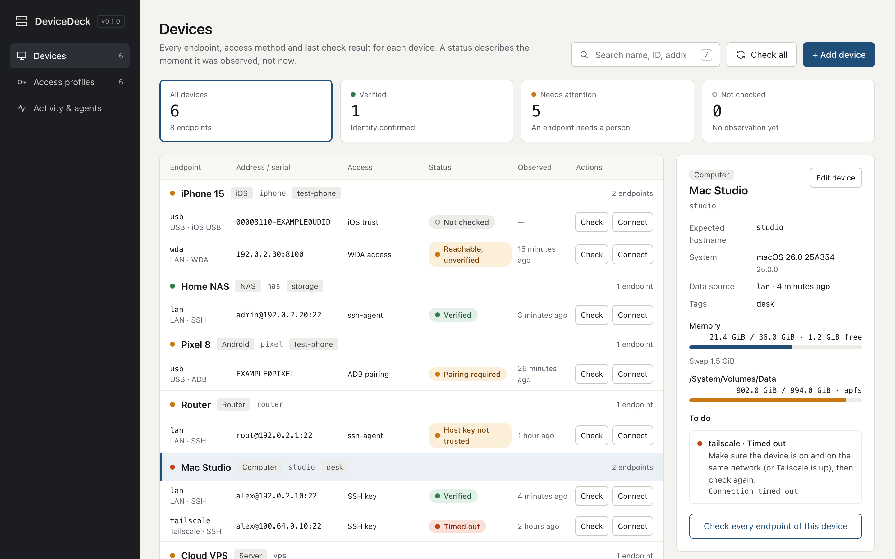

# DeviceDeck

[](https://github.com/biggersun/device-deck/actions/workflows/ci.yml)


**One private registry of your computers, NAS, routers and phones, shared by you, your terminal and your coding agents.**

[中文说明](README.zh-CN.md) · [Management workflow](docs/management.md) · [Architecture](docs/architecture.md) · [Agent setup](docs/agents.md) · [Security](SECURITY.md)



## Why

If you run a home lab, a few servers and a couple of test phones, the facts about them are scattered:

- **Addresses live everywhere.** `~/.ssh/config`, the router's DHCP page, Tailscale, `adb devices`, a note on your phone. The same NAS has a LAN IP at home and a Tailscale IP away, and you keep re-deriving which one to use.
- **"Is it up?" is a guess.** An old ping, a green dot in some dashboard, or a cached Tailscale flag says nothing about whether you can actually log in. An IP that moved can quietly point at a different machine.
- **Agents start from zero every session.** Claude Code or Codex asks "what's the NAS's IP?", or you paste hostnames and usernames into prompts and agent memory files. The worst version is a password pasted into a chat.
- **Phones are their own world.** Android needs an authorized ADB serial, an iPhone needs a trusted UDID, and WebDriverAgent needs a running service. None of that is in your SSH config.

DeviceDeck keeps one small, local inventory that a person, the CLI and an MCP client all read the same way. It does this without ever holding a secret.

## What it does

- **One device, many endpoints.** A device has a stable ID. Its LAN, Tailscale, remote and USB routes are endpoints under it, so you pick a route explicitly and the app never silently switches routes for you.
- **Access profiles, not secrets.** It records *how* you log in: an SSH key path, ssh-agent, a password typed by hand, ADB pairing, iOS trust or WDA access. The schema rejects password, key and pairing-code fields. Your keychain, ssh-agent and phone keep the actual secrets.
- **Verified, not just reachable.** Each check is a fixed, read-only probe. Over SSH it confirms the remote hostname and account match what you registered, under strict host-key checking. The result keeps four things apart:
  - `verified`: the hostname and account match.
  - `reachable_unverified`: something answered, but its identity isn't confirmed.
  - `host_key_untrusted`: the host key hasn't been verified yet.
  - `identity_mismatch`: a different machine or account answered.
- **Honest status.** Every observation carries a timestamp, and missing metrics stay *unknown* instead of being shown as zero. Memory distinguishes free from available on Linux, and APFS volumes are not double-counted.
- **Built for agents.** A local stdio MCP server, built on the official Python SDK, exposes four tools: list devices, get a device, get a connection plan and run a check. There is no arbitrary-command tool, no pairing and no secret retrieval. A portable `SKILL.md` describes the workflow for Claude Code and Codex.
- **A console you'll actually use.** It shows status tiles, a device → endpoint table, next steps for each failure, a protocol-aware editor with a live command preview, connection plans you can copy, and an audit log of what the browser, the CLI and agents did. It is available in Chinese and English, with light and dark themes, and has no build step or CDN.

## Quick start

DeviceDeck needs Python 3.11+ and [uv](https://docs.astral.sh/uv/). It runs on macOS and Linux.

```bash
uv tool install git+https://github.com/biggersun/device-deck
device-deck serve
```

Open **http://127.0.0.1:8765**. Then:

1. Add an access profile, for example *SSH key → `~/.ssh/id_ed25519`*.
2. Add a device with one or more endpoints.
3. Press **Check**.

To try it with fictional sample data first:

```bash
git clone https://github.com/biggersun/device-deck.git && cd device-deck
uv sync --no-editable
uv run --no-editable device-deck --home /tmp/device-deck-demo import examples/inventory.json
uv run --no-editable device-deck --home /tmp/device-deck-demo serve
```

Your real inventory lives in `~/.local/share/device-deck/` by default (directory `0700`, database `0600`). You can override this with `DEVICE_DECK_HOME` or `--home`.

## Connect your agent

**Claude Code:**

```bash
claude mcp add device-deck -- "$(command -v device-deck)" mcp
```

**Codex** (`~/.codex/config.toml`):

```toml
[mcp_servers.device-deck]
command = "/absolute/path/to/device-deck"
args = ["mcp"]
```

The **Activity & agents** page in the console prints both commands with your actual executable path.

Then ask your agent things like:

- "Check the NAS memory and disks over LAN."
- "How do I connect to the test Android phone?"
- "Which of my devices need attention?"

For the optional skill, see [docs/agents.md](docs/agents.md).

## CLI

```bash
device-deck list                      # devices, endpoints, last observation
device-deck plan nas lan              # connection command and prerequisites (runs nothing)
device-deck probe nas lan             # fixed read-only check; saves an observation
device-deck events                    # audit log
device-deck export > inventory.json   # re-importable registry, no observations, no secrets
device-deck import inventory.json     # atomic upsert
```

## What it checks

| Protocol | You set up | DeviceDeck reads |
|---|---|---|
| SSH (macOS, Linux, BusyBox; FreeBSD via fixtures) | Key, agent or manual password; host key verified once by you | Hostname and account identity, OS, memory, swap, filesystems |
| Android ADB | USB debugging approved, or wireless pairing done by you | Model, Android version, memory, `/data` filesystem for one explicit serial |
| iOS USB | libimobiledevice, *Trust this computer* | Device name, model, iOS version for one explicit UDID |
| iOS WDA | An existing signed WebDriverAgent | `/status` only; identity stays unverified |

## Security model, in short

- The web UI binds to `127.0.0.1` only. It enforces Host, Origin and cross-site checks and a strict CSP. MCP is local stdio.
- No secrets are stored, fetched or returned. Password logins remain a human, terminal-only step.
- Probes are fixed scripts with capped output and timeouts. They never install software, pair devices, open ports or run user-supplied commands.
- The SQLite file is **not encrypted**; file permissions protect it from other OS users. Treat backups as private.

For details, see [SECURITY.md](SECURITY.md).

## Status and roadmap

v0.1 is an early, single-user tool. It has been tested daily against real macOS, Linux and BusyBox SSH hosts. The Android and iOS adapters have protocol-fixture coverage but no real-phone acceptance yet. Planned work and known gaps are listed in [TODO.md](TODO.md) and [CHANGELOG.md](CHANGELOG.md). Device actions, automatic pairing, vault retrieval and remote multi-user access are deliberately out of scope until they have their own design.

## Development

```bash
uv sync --extra dev --no-editable
uv run --no-editable pytest
node --check src/device_deck/static/app.js
```

The package is installed non-editable. `[tool.uv] cache-keys` rebuilds it whenever `src/` changes. After editing, run `uv sync --extra dev --no-editable` and restart your MCP client so it picks up the new build. The web UI is plain HTML, CSS and JavaScript in `src/device_deck/static/` and needs no build step.

Contributions are welcome; see [CONTRIBUTING.md](CONTRIBUTING.md) and the [Code of Conduct](CODE_OF_CONDUCT.md). MIT licensed.
