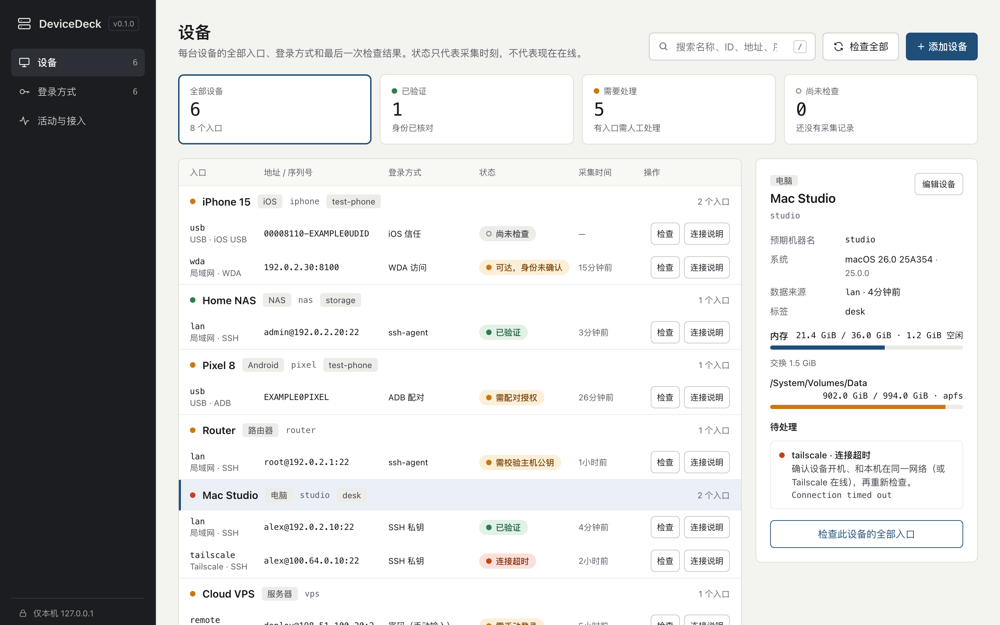

# DeviceDeck

**把你的电脑、NAS、路由器和测试手机登记在一个本机私有清单里，你、命令行和 AI 编程 Agent 看到的是同一份。**

[English](README.md) · [方案说明](docs/plan.zh-CN.md) · [管理流程](docs/management.md) · [Agent 接入](docs/agents.md) · [安全说明](SECURITY.md)

## 解决什么问题

家里有 NAS、路由器、几台电脑，再加上开发用的 Android 和 iPhone，关于它们的信息散落在各处：

- **地址到处都是。** 有的在 `~/.ssh/config`，有的在路由器 DHCP 页面、Tailscale 后台、`adb devices`，或者手机备忘录里。同一台 NAS 在家用局域网 IP，在外用 Tailscale IP，每次都要重新想该走哪条。
- **"在线吗"靠猜。** 一次旧的 ping 结果、某个面板上的绿点，都不代表你现在真的能登录。IP 漂移之后，同一个地址可能已经是另一台机器。
- **Agent 每次从零开始。** Claude Code、Codex 一上来就问 "NAS 的 IP 是多少"；你只好把主机名、用户名贴进提示词和记忆文件，最糟的是把密码贴进对话。
- **手机是另一套体系。** Android 要授权过的 ADB 序列号，iPhone 要信任过的 UDID，WebDriverAgent 还得单独跑着。SSH 配置管不到这些。

DeviceDeck 做的就是一份小而可靠的本机清单。人、CLI 和 MCP 读的是同一份数据，而且它从不保管任何密码或私钥。

## 怎么解决

- **一台设备，多个入口。** 设备 ID 固定不变，局域网、Tailscale、远程、USB 都是它下面的入口。检查时由你明确选择走哪条路，系统不会悄悄换路。
- **只登记登录方式，不存秘密。** 记录的是 "怎么登录"：私钥路径、ssh-agent、手动输入的密码、ADB 配对、iOS 信任或 WDA 访问。数据模型直接拒绝密码、私钥内容和配对码字段，秘密始终留在钥匙串、ssh-agent 和手机里。
- **区分"能连上"和"连对了"。** 每次检查都是固定的只读探测。SSH 会在严格主机公钥校验下，核对远端机器名和账号与登记是否一致。结果会明确分开以下四种情况：
  - 已验证：机器名和账号都对得上。
  - 可达但身份未确认：有设备响应，但无法确认身份。
  - 需校验主机公钥：主机公钥还没有经过你的核对。
  - 设备身份不匹配：响应的是另一台机器或另一个账号。
- **状态说实话。** 每条结果都带采集时间；拿不到的指标显示 "未知"，不会当成 0。Linux 区分空闲内存和可用内存，macOS 不会把 APFS 卷重复累加。
- **为 Agent 设计。** 用官方 MCP Python SDK 提供本机 stdio 服务，只开放四个工具：列设备、读设备、取连接方案、做一次检查。没有任意命令执行，没有自动配对，也不读取任何秘密。安装包里还带一份 Claude Code 和 Codex 共用的 Skill，告诉 Agent 什么时候该检查、怎么汇报结果、怎么和你一起登记设备。
- **可选的本地控制台。** 包括：
  - 状态总览和设备 → 入口表格；
  - 针对每种失败的下一步提示；
  - 按协议切换字段的编辑器，带实时命令预览；
  - 可一键复制的连接方案；
  - 网页、命令行、Agent 的操作审计。

  界面支持中英文、浅色和深色主题，无需构建，也不依赖任何 CDN。

## 安装：把这段话贴给 Agent

需要 macOS 或 Linux、Python 3.11+ 和 [uv](https://docs.astral.sh/uv/)。在能连到你设备的那台电脑上，把下面这段贴给 Claude Code 或 Codex。它会装好工具、把自己接上，然后和你一起登记设备。

```text
帮我安装 DeviceDeck（https://github.com/biggersun/device-deck），并把它接入你自己。

1. 确认 `uv` 可用。如果没有，先停下来问我要不要装。
2. 运行 `uv tool install git+https://github.com/biggersun/device-deck`；如果已经装过，改为运行 `uv tool upgrade device-deck`。装完后如果 PATH 里找不到 `device-deck`，就用 `uv tool dir --bin` 输出的目录。
3. 运行 `device-deck skill install`，为 Claude Code 和 Codex 链接 Skill。如果它报告冲突，告诉我，不要删除任何东西。
4. 用 `command -v device-deck` 得到的绝对路径注册 MCP。只处理本机装了、而且还没有 device-deck 配置的 Agent：
   - Claude Code：`claude mcp add --scope user device-deck -- <绝对路径> mcp`
   - Codex：`codex mcp add device-deck -- <绝对路径> mcp`；或者在 `~/.codex/config.toml` 里加 `[mcp_servers.device-deck]`，`command` 填这个路径，`args = ["mcp"]`，其他配置不要动。
5. 读取 `device-deck skill path` 输出的目录里的 `SKILL.md`，按其中「Registering or updating devices」一节，和我一起登记设备。先问我有哪些设备。不要向我要密码或私钥。
6. 最后提醒我新开一个会话，让 MCP 工具和 Skill 生效。
```

<details>
<summary>想自己手动装？</summary>

```bash
uv tool install git+https://github.com/biggersun/device-deck
device-deck skill install
claude mcp add --scope user device-deck -- "$(command -v device-deck)" mcp
codex mcp add device-deck -- "$(command -v device-deck)" mcp
```

然后在控制台（`device-deck serve`）里添加设备，或者用 `device-deck import inventory.json` 导入，格式见 [`examples/inventory.json`](examples/inventory.json)。更多说明见 [docs/agents.md](docs/agents.md)。

</details>

数据默认保存在 `~/.local/share/device-deck/`（目录权限 700，数据库 600），可以用 `DEVICE_DECK_HOME` 或 `--home` 改到别的位置。

## 日常使用：直接问

装好之后什么都不用打开。在任意一个 Claude Code 或 Codex 会话里直接问：

- "NAS 在线吗？磁盘还剩多少？"
- "测试用的 Android 手机怎么连？"
- "我有哪些设备需要处理？"
- "NAS 的局域网地址换成 192.168.1.30 了，帮我改一下。"
- "把我新买的树莓派登记进去。"

Agent 会按你当前所在的网络选入口，做一次固定的只读检查，告诉你查到了什么、是什么时候查的。只有你能做的事，比如确认主机公钥、允许 USB 调试、输入密码，它会告诉你下一步怎么做，而不会替你去做。

## 控制台（可选）

```bash
device-deck serve
```

想一次看全貌时，打开 **http://127.0.0.1:8765**。可以看到每台设备和入口的状态，用按协议切换字段的编辑器改设备，复制连接方案，查看网页、命令行和 Agent 的操作记录，也能确认 MCP 和 Skill 有没有装好。



## 当前状态

v0.1 是单用户早期版本，已在真实的 macOS、Linux 和 BusyBox SSH 设备上日常使用。Android 和 iOS 目前只有协议样例测试，还没做真机验收。设备操作、自动配对、密码库读取和远程多用户访问都刻意不在范围内。后续计划见 [TODO.md](TODO.md)。

MIT 协议，欢迎贡献，详见 [CONTRIBUTING.md](CONTRIBUTING.md)。
