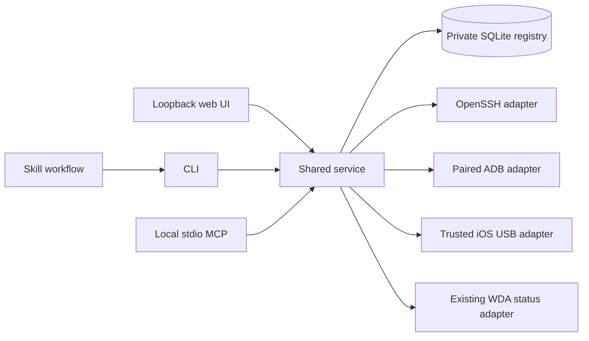

# Architecture and contracts

`models.py` rejects unknown fields and validates identifiers, hosts and protocol prerequisites. `store.py` makes registry imports atomic, verifies all credential references including existing records, and stores observations separately from intended inventory. `service.py` selects an explicit endpoint and records a bounded, typed result. `adapters.py` contains fixed probes and connection-plan generation. Web, CLI and MCP have no separate inventory files.

The data directory is resolved at runtime from `DEVICE_DECK_HOME`, `--home`, or `~/.local/share/device-deck`. It is outside source control. Directory mode is 0700 and database mode 0600. Credential metadata includes a method and external references; no secret material is fetched. A filesystem path is not proof a key is usable. Existing SSH aliases are checked for effective host, username and port before connection.

Results distinguish `verified`, `reachable_unverified`, `timeout`, `authentication_failed`, `host_key_untrusted`, `configuration_mismatch`, `identity_mismatch`, `interactive_required`, `dependency_missing`, `pairing_required`, `not_connected`, `wda_unavailable` and `invalid_response`. Missing metrics remain null. The app does not interpret a cached Tailscale online flag as a verified SSH connection.

macOS probes distinguish physical memory, file cache and swap; APFS system/data volumes are not added together as if independent disks. Linux distinguishes available memory from free memory and lists zram separately from disk swap. Loopback image filesystems and pseudo filesystems are excluded from user-facing disk totals. Volumes are shown individually; RAID redundancy and SMART health are not inferred.

## Extending transports

Add an endpoint protocol and matching credential methods to the validation contract, an adapter in `ADAPTERS`, a connection plan, protocol fixtures and real-device acceptance evidence. An adapter returns only typed observation fields or `ProbeFailure`; it must not expose arbitrary commands, secrets or unbounded device output. Do not equate protocol support with pairing permission or device control.

## Deliberate v0.1 boundaries

SSH uses the local client's configuration and explicit strict host-key options. ADB can start its normal local daemon as part of the client protocol but does not pair phones. WDA reads one registered host's HTTP `/status` without redirects or ambient HTTP proxies; it does not create a session. The web UI is single-user loopback-only, not an authenticated Internet service. Remote authenticated MCP, policy-controlled device actions and vault retrieval need separate designs before implementation.
